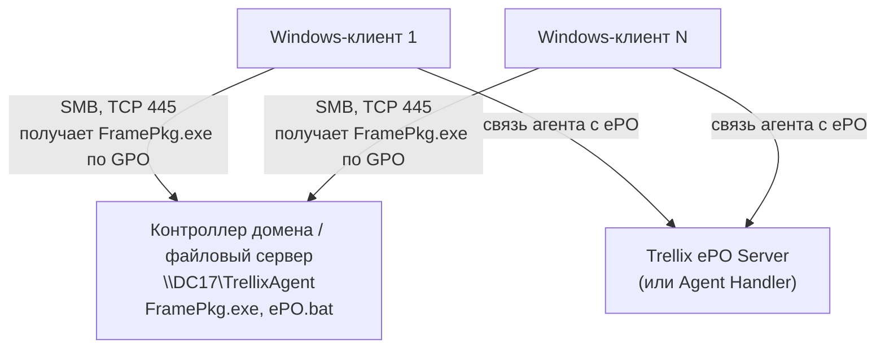

# Установка Trellix Agent 5.8.x в Windows с помощью сценариев GPO

Инструкция по массовой установке Trellix Agent (ранее McAfee Agent) на доменные рабочие станции Windows через сценарий запуска групповой политики (Startup Script). В конце приведён альтернативный вариант через сценарий входа пользователя (Logon Script).

## Содержание

- [Исходные данные](#исходные-данные)
- [Схема развёртывания](#схема-развёртывания)
- [Подготовка](#подготовка)
- [Настройка](#настройка)
  - [1. Сетевая папка](#1-сетевая-папка)
  - [2. Установочный пакет агента](#2-установочный-пакет-агента)
  - [3. Пакетный файл ePO.bat](#3-пакетный-файл-epobat)
  - [4. Размещение ePO.bat](#4-размещение-epobat)
  - [5. Объект групповой политики](#5-объект-групповой-политики)
  - [6. Применение политики на клиентах](#6-применение-политики-на-клиентах)
- [Проверка результата](#проверка-результата)
- [Альтернатива: сценарий входа пользователя](#альтернатива-сценарий-входа-пользователя)

## Исходные данные

В этой инструкции установка агента назначается подразделению (OU) **Trellix Workstations**, в котором находится тестовый хост **WIN11GPO** домена `edusiem.lab`.

| Параметр | Значение в примере |
|---|---|
| Домен | `edusiem.lab` |
| Контроллер домена | `DC17` |
| OU с целевыми хостами | `Trellix Workstations` |
| Тестовый хост | `WIN11GPO` |
| Сетевая папка | `\\DC17\TrellixAgent` |
| Объект GPO | `Deploy Trellix Agent` |


> [!IMPORTANT]
> Имена сервера, домена, OU и пути к сетевой папке в примерах замените значениями вашей инфраструктуры.

## Схема развёртывания



## Подготовка

Перед установкой убедитесь, что есть:

- доступ к контроллеру домена;
- права **Domain Admins** или делегированные права на управление GPO;
- сетевой ресурс, доступный на чтение всем доменным компьютерам.

## Настройка

### 1. Сетевая папка

Создайте сетевую папку, например `\\DC17\TrellixAgent`, и дайте доступ на чтение группе **Domain Computers**.


> [!NOTE]
> Сценарий запуска (Startup Script) выполняется от имени учётной записи компьютера, поэтому права на чтение нужны именно группе **Domain Computers**.

### 2. Установочный пакет агента

1. В консоли ePO откройте **Меню → Системы → Дерево систем** и выберите **Новые системы**
   (*Menu → Systems → System Tree → New Systems*).
2. Выберите **Создать и загрузить установочный пакет агента** (*Create and download agent installation package*).
3. Выберите подходящую версию агента для Windows.
4. Снимите флажок **Встроить учётные данные в пакет** (*Embed Credentials in Package*), чтобы получить пакет по умолчанию.
5. Назначьте обработчик агентов для связи с сервером ePO:
   **Все обработчики агентов** (*All Agent Handlers*) — все обработчики могут взаимодействовать с локальным сервером ePO.
6. Нажмите **ОК**. Будет создан установочный пакет **FramePkg.exe**.


Скопируйте **FramePkg.exe** в сетевую папку из шага 1 (`\\DC17\TrellixAgent`), доступную целевым системам.

### 3. Пакетный файл ePO.bat

Создайте пакетный файл **ePO.bat** — его команды выполняются на рабочей станции при каждой загрузке. Скрипт проверяет запись агента в реестре и, если агент не установлен, запускает **FramePkg.exe** с параметром `/install=agent`.

Готовый файл: [`scripts/ePO.bat`](scripts/ePO.bat)

```bat
@echo off
set MA_KEY_NAME=HKLM\SOFTWARE\McAfee\Agent
set MA_VALUE_NAME=InstallPath
set INSTALLER=\\DC17\TrellixAgent\FramePkg.exe
set LOG=C:\GPO_Install_Log.txt

set "Home="
FOR /F "usebackq skip=2 tokens=1,2*" %%A IN (`REG QUERY "%MA_KEY_NAME%" /v %MA_VALUE_NAME% 2^>nul`) DO (
    set "Home=%%C"
)

if defined Home goto :installed

echo [%date% %time%] Trellix Agent not found, installing from %INSTALLER% >> "%LOG%"
"%INSTALLER%" /install=agent /silent
echo [%date% %time%] FramePkg.exe finished, exit code %ERRORLEVEL% >> "%LOG%"
exit /b 0

:installed
echo [%date% %time%] Trellix Agent is already installed: %Home% >> "%LOG%"
exit /b 0
```

> [!WARNING]
> Значение `INSTALLER` (`\\DC17\TrellixAgent\FramePkg.exe`) нужно заменить путём к сетевому каталогу в вашей инфраструктуре.

Ход выполнения записывается в `C:\GPO_Install_Log.txt` на рабочей станции.

### 4. Размещение ePO.bat

Сохраните **ePO.bat** в сетевой папке `\\DC17\TrellixAgent` (для варианта со сценарием запуска) или в папке **NETLOGON** контроллера домена (для [сценария входа пользователя](#альтернатива-сценарий-входа-пользователя)).


### 5. Объект групповой политики

1. Создайте объект групповой политики **Deploy Trellix Agent**.

   

2. Откройте его на редактирование и перейдите в раздел
   **Конфигурация компьютера → Политики → Параметры Windows → Сценарии (запуск/завершение работы)**
   (*Computer Configuration → Policies → Windows Settings → Scripts (Startup/Shutdown)*).

   

3. Дважды щёлкните **Запуск** (*Startup*) и нажмите **Добавить** (*Add*).

   

4. Нажмите **Обзор** (*Browse*), перейдите в папку `\\DC17\TrellixAgent` и выберите файл сценария **ePO.bat**.

   

5. Привяжите GPO к целевым компьютерам. В оснастке **Управление групповыми политиками** (*Group Policy Management*) щёлкните правой кнопкой мыши OU с компьютерами, на которые нужно установить агент (в примере — **Trellix Workstations**).

   

6. Выберите **Связать существующий объект групповой политики** (*Link an Existing GPO*)…

   

7. …и укажите **Deploy Trellix Agent**.

   

### 6. Применение политики на клиентах

На тестовой рабочей станции **WIN11GPO** откройте командную строку от имени администратора и выполните:

```cmd
gpupdate /force
```

Затем перезагрузите **WIN11GPO** — сценарий запуска выполнится при загрузке.

## Проверка результата

После перезагрузки проверьте, что Trellix Agent установлен и запущен:

```cmd
type C:\GPO_Install_Log.txt
reg query HKLM\SOFTWARE\McAfee\Agent /v InstallPath
sc query masvc
```

Хост также должен появиться в дереве систем консоли ePO.

## Альтернатива: сценарий входа пользователя

Вместо сценария запуска компьютера можно вызывать **ePO.bat** из сценария входа пользователя. Для этого добавьте в сценарий входа (или в поле **Logon script** на вкладке **Profile** свойств пользователя) строку, вызывающую пакетный файл с основного контроллера домена:

```cmd
CALL \\DC17\NETLOGON\ePO.bat
```


> [!NOTE]
> Сценарий входа выполняется с правами пользователя. Для установки агента у пользователя должны быть права локального администратора, поэтому для массового развёртывания предпочтителен сценарий запуска компьютера (шаг 5).
